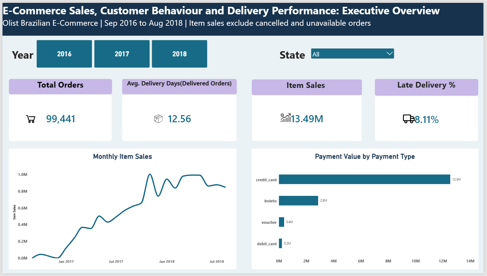
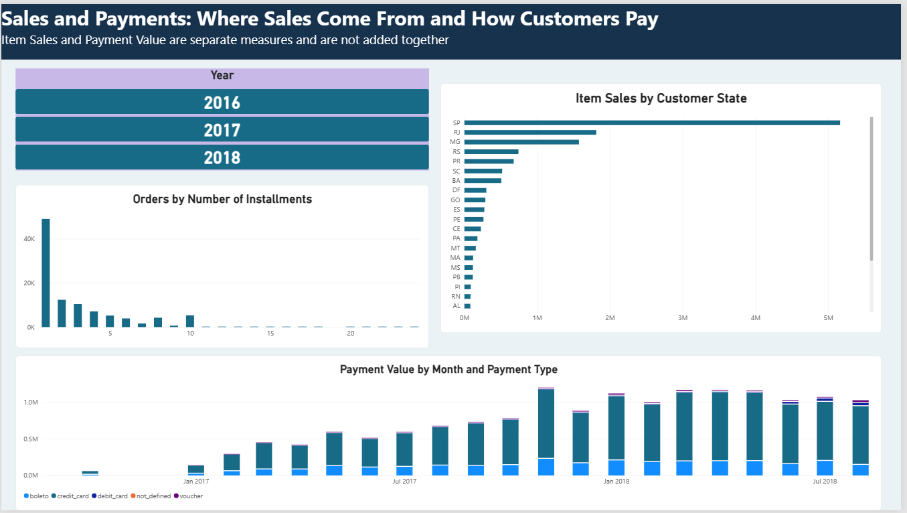
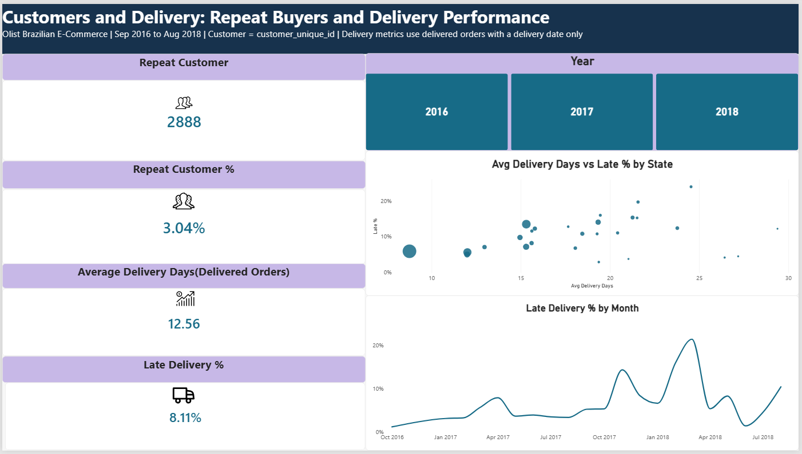

# E-Commerce Sales, Customer Behaviour and Delivery Performance Analytics

An analytics project on the public Olist Brazilian E-Commerce dataset, using PostgreSQL, SQL and Power BI.

## Business questions

1. How do orders and sales change month by month?
2. How do customers pay?
3. How long does delivery take, and how often is it late?
4. Are late deliveries associated with lower review scores?
5. Do customers buy again?
6. Which states account for most sales?

## Dashboard

## Key findings

| # | Finding | Evidence |
|---|---|---|
| 1 | November 2017 was the peak month (only one November exists, so not called seasonal) | 7,421 orders, 1,003,862.14 item sales |
| 2 | Credit card dominates payments | About 78.3% of payment value, 3.5 installments on average |
| 3 | About 1 in 12 delivered orders arrived late | 7,826 of 96,470 (8.11%), average 12.56 days |
| 4 | Late deliveries spiked in March 2018 | 21.04% of 7,003 delivered orders |
| 5 | Late % rose from June to August 2018 | About 1.4%, 4.5% and 10.4% |
| 6 | Few customers buy again | 2,888 of 94,990 customers (3.04%) |
| 7 | Sales are concentrated in a few states | SP 38.3% of item sales, top 5 states about 73.9% |
| 8 | Late deliveries are associated with lower review scores (association, not proven cause) | Average 2.57 (late) vs 4.29 (on time); 54.1% vs 9.2% low (1 to 2 star) reviews |

Full details, recommendations and limitations: [docs/executive_summary.md](docs/executive_summary.md)

## Data

- Source: [Olist Brazilian E-Commerce dataset](https://www.kaggle.com/datasets/olistbr/brazilian-ecommerce) (Kaggle, public), 9 CSV files. Four core tables plus reviews were analysed.
- Raw files are not included. See [data/README.md](data/README.md).
- Trends cover Sep 2016 to Aug 2018. Sep and Oct 2018 contain only 20 orders, and Sep to Dec 2016 are very thin (Nov 2016 has none).

## Workflow

1. Loaded the raw CSVs unchanged into a `staging` schema in PostgreSQL (all columns as text).
2. Checked data quality with SQL: key uniqueness, missing delivery dates, payment totals, review duplicates.
3. Built typed `clean` tables with primary keys: orders, order_items, order_payments, customers, order_reviews (`sql/01_clean_tables.sql`).
4. Wrote the SQL analysis, including CTEs, window functions and conditional aggregates (`sql/02_analysis.sql`).
5. Built a 3-page Power BI dashboard with 12 DAX measures plus a review-score measure, and reconciled key totals with SQL.

## Metric definitions

- **Item sales:** sum of `price` for orders not cancelled or unavailable. Freight and payment value are separate measures and are never added to sales.
- **Delivered order (delivery metrics):** status `delivered` with a delivery date (96,470 orders).
- **Delivery duration:** delivered date minus purchase date, in days.
- **Late order:** delivered date later than the estimated date (`is_late`).
- **Customer:** distinct `customer_unique_id`. **Repeat customer:** 2 or more eligible orders (not cancelled or unavailable).
- **Review score per order:** score of the latest review for that order. Orders without a review are excluded from review metrics.

## Validation

SQL and Power BI were compared on item sales (13,494,400.74 excluding cancelled and unavailable orders; 13,591,643.70 including them), payment value, late orders, repeat customers, average delivery days, 2017 sales, SP sales and average review score. All of these matched.

## Limitations

**Data coverage**
- Static historical snapshot, not a live feed.
- Sep and Oct 2018 contain only 20 orders, and none are delivered.
- Sep to Dec 2016 have very few orders (Nov 2016 has none).
- About two years of data, so later repeat purchases are not visible.

**Data quality**
- 8 delivered orders have no delivery date and are excluded from delivery metrics.
- Payments do not always equal item sales plus freight: 98,362 orders match, 264 paid more, 39 paid less, and 775 have payments but no item rows. Cause not identified.
- 3 payment records have type `not_defined` with value 0.
- Reviews are not one per order in the raw data. The latest review is kept, and 768 orders have no review.

**Metric scope**
- No cost data, so no profit analysis. Currency is not specified.
- Repeat rate is not customer lifetime value.
- Late % by month hides months with fewer than 100 orders (a chart filter).

**Analysis scope**
- Findings show associations, not causes.
- Products and sellers were not analysed.
- The Power BI file is not included in this repository.

## Repository contents

- `sql/01_clean_tables.sql`: builds the clean layer from staging
- `sql/02_analysis.sql`: analysis queries
- `docs/`: dashboard screenshots and executive summary
- `data/README.md`: where to get the data

## How to reproduce

1. Download the dataset from Kaggle and load the 9 CSVs unchanged into `staging` tables in PostgreSQL (all columns as text).
2. Run `sql/01_clean_tables.sql`, then the queries in `sql/02_analysis.sql`.
3. Rebuild the dashboard from the `clean` tables using the metric definitions above.
